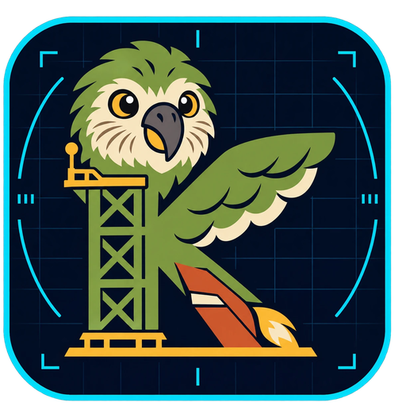
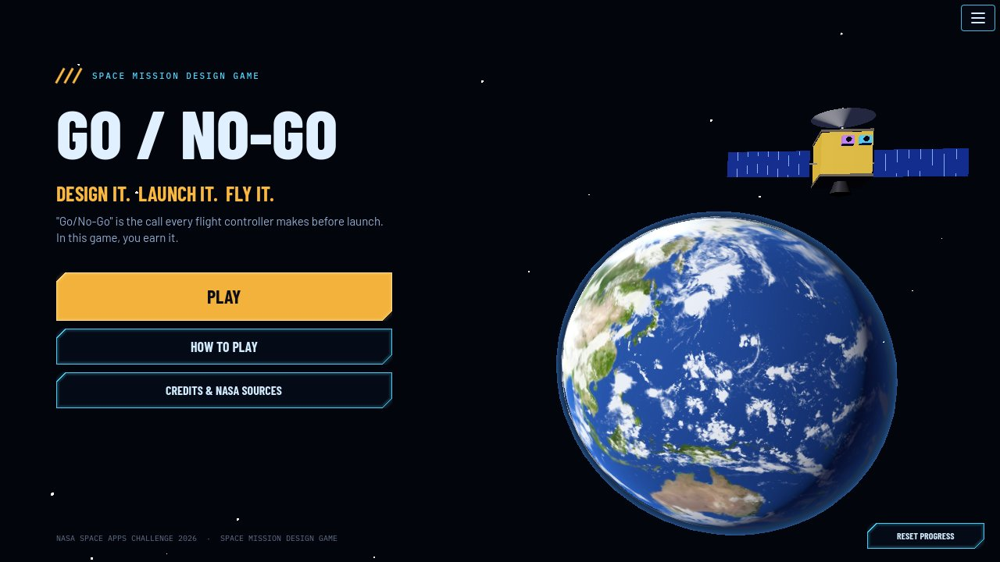
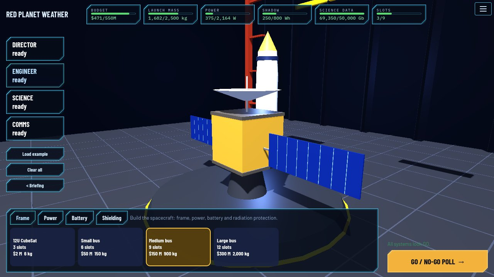
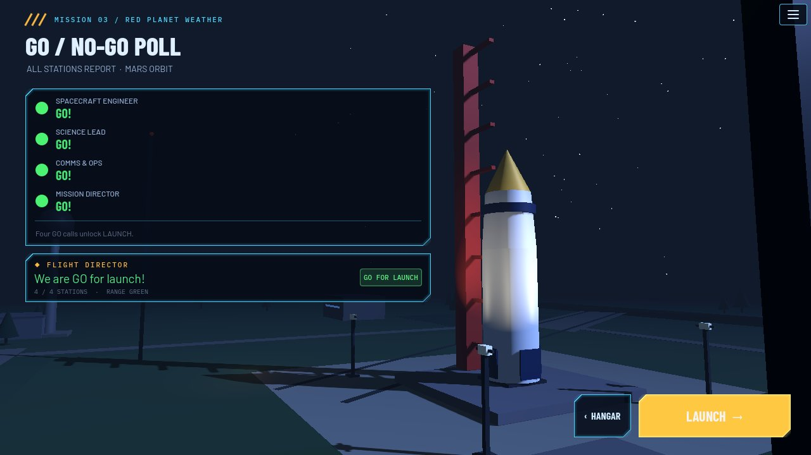
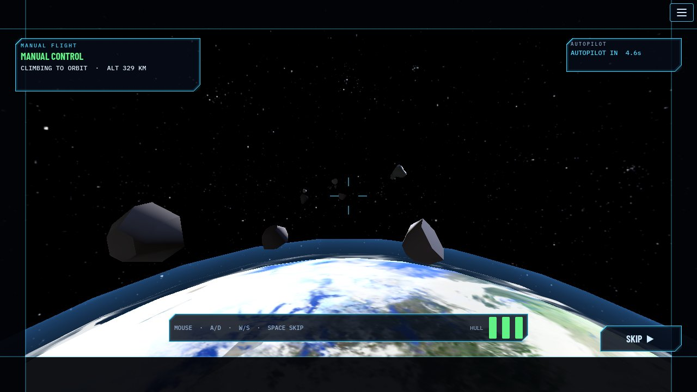
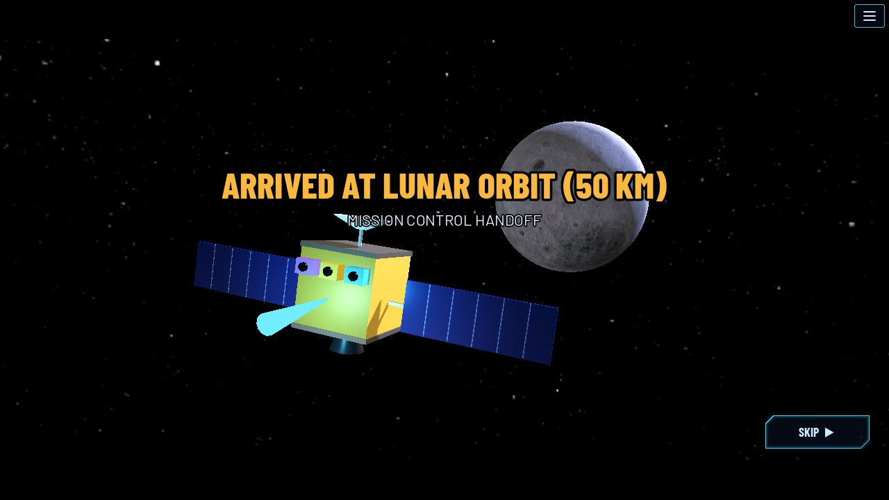
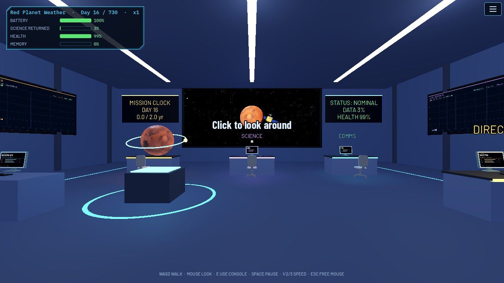
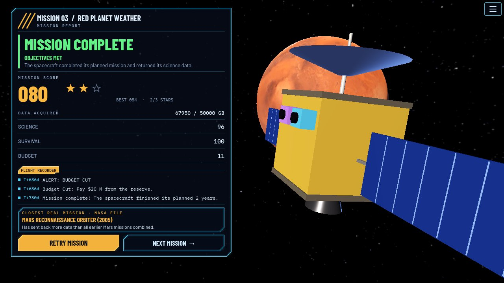

<p align="center">
  
</p>

<h1 align="center">Go/No-Go</h1>

<p align="center">
  <b>Design it. Launch it. Fly it.</b><br>
  A space mission design game by <b>Team Kakapo</b> for the <b>NASA Space Apps Challenge 2026</b> (challenge: <i>Space Mission Design Game</i>).
</p>

<p align="center">
  <a href="LICENSE"></a>
  
  
</p>

<p align="center">
  <b>▶ Play it now in your browser:</b> [itch.io link] &nbsp;·&nbsp; no download, no install
</p>



---

## What is it?

"Go/No-Go" is the call every flight controller makes before a real launch. In this game, **you earn it.**

You lead a robotic space mission from start to finish. You **design** the spacecraft, get it through the **launch poll**, **launch** it, and then **fly it from Mission Control** while things go wrong in space. At the end you're scored, and the game shows you **which real NASA mission your spacecraft is most like**.

The big idea: **there is no perfect spacecraft.** A bigger camera returns more science, but it is heavier, needs more power, sends more data home and costs more money. Real mission engineers balance these trade-offs every day. Go/No-Go lets anyone *feel* them in a few minutes, by making the decisions themselves.

## How to play

| | Step | What you do |
|---|---|---|
| 🪐 | **1. Pick a mission** | Five missions, from easy to hard, unlocked one by one across the Solar System. |
| 🛠️ | **2. Build the spacecraft** | In a 3D hangar, four stations choose the parts: **Director** (rocket, mission length), **Engineer** (frame, solar panels or nuclear power, battery, shielding), **Science** (cameras and instruments) and **Comms** (antenna, data storage). Bars show budget, mass, power and data as you build. |
| ✅ | **3. Go/No-Go poll** | Each flight controller checks your design and calls **GO** or **NO-GO**, and every NO-GO tells you what to fix. Four GOs unlock the launch. |
| 🚀 | **4. Launch** | Watch the liftoff and stage separation, then steer through an asteroid field (or space debris near Earth). Every hit damages the spacecraft, and three hits destroy it. |
| 🖥️ | **5. Mission Control** | Walk around a first-person 3D control room on Earth. Time runs fast and problems pop up: solar storms, a dying battery, a full memory, a surprise discovery. Go to the blinking console and act before time runs out. |
| 📊 | **6. Debrief** | You get a score for **science** returned, **survival** (spacecraft health) and **budget** left, plus 1 to 3 stars and the real NASA mission your design resembles. |

### The missions

| # | Mission | Destination | Goal | Budget |
|---|---|---|---|---|
| 1 | **Fire Watch** | Low Earth orbit (500 km) | Map wildfires and the health of forests | $150 M |
| 2 | **Moon Mapper** | Lunar orbit (50 km) | Map the surface, look for water ice in dark craters | $300 M |
| 3 | **Red Planet Weather** | Mars orbit | Study the atmosphere and track giant dust storms | $550 M |
| 4 | **Giant's Secret** | Jupiter orbit | Look inside Jupiter: deep atmosphere, core, magnetic field | $900 M |
| 5 | **Ringworld** | Saturn orbit | Study the rings and the icy plumes of Enceladus | $1,200 M |

The farther you go, the harder it gets: sunlight gets weaker (solar panels make less power), radio signals take minutes to arrive, and radiation is stronger.

### Difficulty

- **Easy:** when a problem appears, you choose from a few answers, and the recommended one is shown in green.
- **Normal / Hard:** no hints. Pick the right repair tool yourself; a wrong tool costs money. Problems come faster on Hard.
- The first mission includes a short tutorial.

## Screenshots

| 3D hangar | Go/No-Go poll |
|---|---|
|  |  |
| **Climbing to orbit, dodging space debris** | **Arriving at the Moon** |
|  |  |
| **Mission Control** | **Debrief** |
|  |  |

## Controls

| Where | Controls |
|---|---|
| Menus, hangar, poll | Mouse. In the hangar, drag to orbit the camera and scroll to zoom. Right-click a part to remove it. |
| Launch flight | **Mouse** or **WASD / arrow keys** to steer (W = up, S = down). **Space** skips the cinematic. |
| Mission Control | **Mouse** to look, **WASD** to walk, **E** to use a console, number keys **1–9** for console actions, **Space** to pause, **1 / 2 / 3** for time speed |
| Anywhere | **Esc** opens the menu, **F11** toggles fullscreen, **M** mutes |

## Built on NASA resources

The game's parts, numbers and process are based on official NASA material, simplified for play but kept in realistic proportion:

- **[NASA CubeSat 101](https://www3.nasa.gov/sites/default/files/atoms/files/nasa_csli_cubesat_101_508.pdf)**: CubeSat sizes and mass, launch cost references, and the mission phases and early operations.
- **[NASA "Design and Develop Science Missions"](https://www.nasa.gov/wp-content/uploads/2025/04/250323-design-and-develop-science-mission.pdf)** (SmallSat Institute, 2025): the four mission segments that became our four stations, and the need → concept → requirements → design process behind our game flow and launch check.
- **[NASA Mission Design Lab](https://etd.gsfc.nasa.gov/capabilities/integrated-design-center/mission-design-lab/)** and **[JPL Concept Maturity Levels](https://dataverse.jpl.nasa.gov/dataset.xhtml?persistentId=hdl:2014/44299)**: comparing designs by cost and risk, and reviewing a design before it goes ahead.
- **Real NASA missions** used in the debrief, with facts checked on [science.nasa.gov](https://science.nasa.gov): Landsat 9, PACE, LRO, MRO, MAVEN, Juno, Europa Clipper and Cassini, plus NASA's CubeSat Launch Initiative.
- **Physics in the game:** sunlight drops with the square of the distance from the Sun, batteries drain in planet shadow, signal delay follows the speed of light, and radiation is harsher near Jupiter.

*Go/No-Go is a fan-made educational project for the Space Apps Challenge. It is not an official NASA product and uses no NASA logos.*

## Run it from source

1. Install **[Godot 4.7.2](https://godotengine.org/download)** (the standard version).
2. Clone this repository:
   ```bash
   git clone https://github.com/rashedutm/Go-No-Go.git
   ```
3. Open Godot, click **Import**, select `project.godot` in the cloned folder, and press **F5** to play.

**Build the web version:** in Godot, choose **Project → Export → Web → Export Project**. The "Web" preset is already set up; it needs the Godot 4.7.2 export templates. The output goes to `export/web/index.html`; serve that folder (or zip it for itch.io).

**Run the tests (optional):**
```bash
godot --headless --path . res://tests/flow_test.tscn
```
This plays the whole game automatically, from the title screen to the debrief, and prints `RESULT: FULL FLOW OK`.

## Project structure

```
data/         Missions, parts, events and real-mission data (JSON); tune the game here
scenes/       Title, campaign map, briefing, hangar, Go/No-Go poll, launch, Mission Control, debrief
scripts/      Game state, simulation, events, sound, 3D spacecraft builder, UI helpers
art/ audio/   Planet textures, 3D models, sounds and music
ui/           Theme, fonts, icons, logo
tests/        Automated tests and screenshot scenes
docs/         Screenshots and our development notes
```

## Team

Made in one weekend for NASA Space Apps Challenge 2026 by **Team Kakapo** 🦜:

- **Rashed** (team lead)
- **Emon**
- **Danial**

## Use of AI

AI tools helped us build this project: **Claude (by Anthropic)** helped write code, game text and documentation, and code files are marked with a header comment. The background music and the alarm and stinger sounds were generated in code for this game. No NASA logos or insignia are used anywhere.

## Credits & license

- **Code:** [MIT License](LICENSE).
- **Third-party assets keep their own licenses:** planet textures by [Solar System Scope](https://www.solarsystemscope.com/textures/) (CC BY 4.0, based on NASA data), sounds and the computer model by [Kenney](https://kenney.nl) (CC0), asteroid models by KayKit (CC0), office chair by Abstract_Duck (MIT), Barlow and IBM Plex Mono fonts (SIL OFL 1.1), Lucide icons (ISC) and the [Godot Engine](https://godotengine.org) (MIT).
- Full list: [content/CREDITS.md](content/CREDITS.md).
